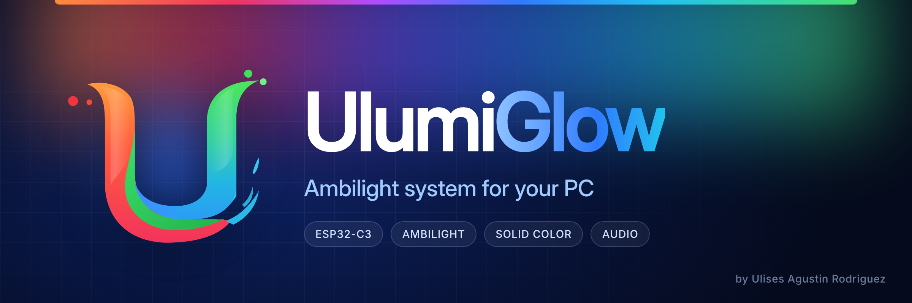
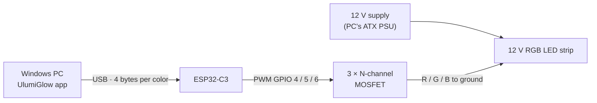

<p align="center">
  
</p>

<p align="center">
  <a href="README.md">Español</a> · <b>English</b>
</p>

<p align="center">
  <a href="LICENSE"></a>
  
  
  
  <a href="https://github.com/UlisesSB/UlumiGlow/releases/latest"></a>
</p>

**UlumiGlow** turns any ordinary (cheap, non-addressable) RGB LED strip into **Ambilight** lighting for your computer. A lightweight app lives in the Windows tray, watches an area of the screen, computes the average color and sends it over USB to an **ESP32-C3**, which drives the strip with PWM through three MOSFETs.

The project is meant to stay **simple**: few parts, short code and no complicated setup.

## Features

- **Ambilight**: the strip mirrors the color of whichever part of the screen you choose.
- **Zone map** with presets (top, bottom, left, right or full screen) or a **custom zone** you draw by dragging over a capture of your monitor.
- **Solid color**: pick a color and it stays on, even after closing the app.
- **Audio mode**: the strip pulses with your PC's sound. Bass drives the beat, treble spins the colors.
- **Lives in the tray**: one click turns it on or off, right click opens the menu.
- **Reconnects automatically** if you unplug and plug the ESP32 back in.
- **Safe shutdown**: in Ambilight and Audio modes, the strip turns off by itself if the PC stops sending data.
- **Protects your MOSFETs**: the firmware caps the maximum brightness so they stay cool.
- Blue *liquid glass* interface, global brightness and two color curves to compare.

## Screenshots

<p align="center">
  
  
</p>
<p align="center">
  
  
</p>

<sub>The interface is in Spanish.</sub>

## How it works



1. The app captures the selected zone about 20 times per second and averages its color.
2. It smooths it, applies the color curve and brightness, and sends it over USB.
3. The ESP32 receives the color and outputs three PWM signals (red, green and blue).
4. Each MOSFET switches its strip channel to ground in proportion to that signal, which produces the in-between colors.

## Bill of materials

| Part | Qty | Notes |
|---|:---:|---|
| ESP32-C3 SuperMini (or any ESP32-C3 with native USB) | 1 | Powered by the same USB cable from the PC |
| **IRFZ44N** N-channel MOSFET (TO-220) | 3 | Even better: IRLZ44N or IRLB8721 (logic level, see note) |
| 220 Ω resistor | 3 | Between each GPIO and the gate |
| 10 kΩ resistor | 3 | Gate pull-down to ground |
| 12 V **non-addressable** RGB LED strip (4 pins: +12V, R, G, B) | 1 | Common anode, the most common type |
| 12 V power supply | 1 | A 12 V lead from the PC's ATX PSU or an external adapter |
| Breadboard or perfboard, wires and a USB-C data cable | – | |

> [!NOTE]
> The IRFZ44N is not a logic-level MOSFET: at the ESP32's 3.3 V it only half-conducts and heats up. That is why the firmware caps brightness at 63 %. With an IRLZ44N or IRLB8721 you can raise `BRIGHT_LIMIT` to 255 in [`firmware/src/main.cpp`](firmware/src/main.cpp).

## Wiring

<p align="center">
  
</p>

| ESP32-C3 | Goes to | LED strip |
|---|---|---|
| GPIO 4 | Q1 gate (through 220 Ω) → Q1 drain | R |
| GPIO 5 | Q2 gate (through 220 Ω) → Q2 drain | G |
| GPIO 6 | Q3 gate (through 220 Ω) → Q3 drain | B |
| GND | Common ground (MOSFET sources and PSU ground) | – |
| – | +12 V from the PSU | +12V |

The step-by-step guide, with tips and troubleshooting, is in **[docs/assembly.md](docs/assembly.md)**.

## Installation

1. **Build the circuit** following the diagram above.
2. **Flash the firmware** to the ESP32-C3 with [PlatformIO](https://platformio.org/): open the `firmware/` folder in VS Code and click *Upload* (or run `pio run -t upload`).
3. **Install the app** by downloading `UlumiGlow_Setup_x.y.z.exe` from [Releases](https://github.com/UlisesSB/UlumiGlow/releases/latest).
4. Plug the ESP32 in over USB. UlumiGlow finds it automatically and the strip lights up.

## Usage

| Action | Result |
|---|---|
| Click the tray icon | Turns the strip on or off |
| Right click → *Modo* | Switches between Ambilight, Solid color and Audio |
| Right click → *Configuración…* | Opens the settings window |
| Close the window | Sends it to the tray; the app keeps running |
| Right click → *Salir* | Quits UlumiGlow (solid color stays on, other modes turn the strip off) |

When you open the app manually an intro plays, then you can choose **Configurar** (settings) or **Minimizar a la bandeja** (minimize to tray). When it starts with Windows it goes straight to the tray.

Settings are stored in `%APPDATA%\UlumiGlow\config.json` and the error log in `ulumiglow.log` in the same folder.

## Protocol

The app and the firmware talk using 4-byte packets at **115200 baud**:

| Packet | Use | If the PC stops sending |
|---|---|---|
| `0xAA R G B` | Live color (Ambilight, Audio) | The strip turns off after 3 s |
| `0xAB R G B` | Solid color (also used to switch off when paused) | The color stays on |

## Development

```powershell
cd app
pip install -r requirements.txt
python main.py           # with intro
python main.py --tray    # straight to the tray
```

How to build the `.exe`, the installer and publish a release: **[docs/building.md](docs/building.md)**.

## Repository layout

```
UlumiGlow/
├── app/                    Windows app (Python)
│   ├── main.py             Entry point
│   ├── ulumiglow/          Logic: config, ESP32, modes, engine, tray
│   │   └── ui/             Window: window.py + web/ (HTML, CSS, JS)
│   ├── assets/             App icons
│   ├── installer/          Inno Setup script
│   ├── build.bat           Builds the .exe with PyInstaller
│   └── requirements.txt
├── firmware/               ESP32-C3 firmware (PlatformIO)
├── assets/                 Logo (SVG and 4096 px PNG), icon and banners
├── docs/                   Assembly and build guides, images
├── CHANGELOG.md
└── LICENSE
```

## Roadmap

- [ ] Several zones and several strips at once (more than one signal per ESP32).

## License

Released under the **MIT** license: you are free to use, modify and share it, as long as you keep the copyright notice crediting the author. See [LICENSE](LICENSE).

The [Inter](https://github.com/rsms/inter) typeface used by the interface is distributed under the SIL Open Font License 1.1.

## Author

**Ulises Agustin Rodriguez**

- Portfolio: [uarodriguez.com](https://uarodriguez.com)
- GitHub: [@UlisesSB](https://github.com/UlisesSB)
- Contact: [uarodriguez@computer.org](mailto:uarodriguez@computer.org)

<sub>Copyright © 2025-2026 Ulises Agustin Rodriguez.</sub>
