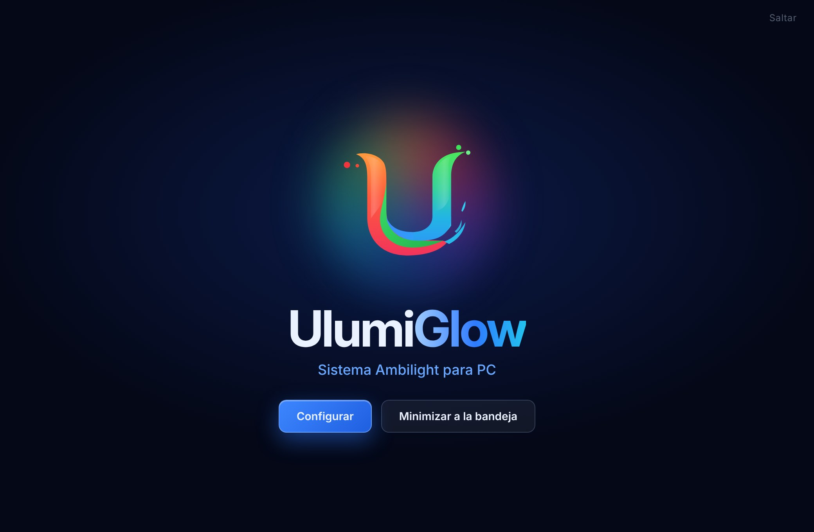
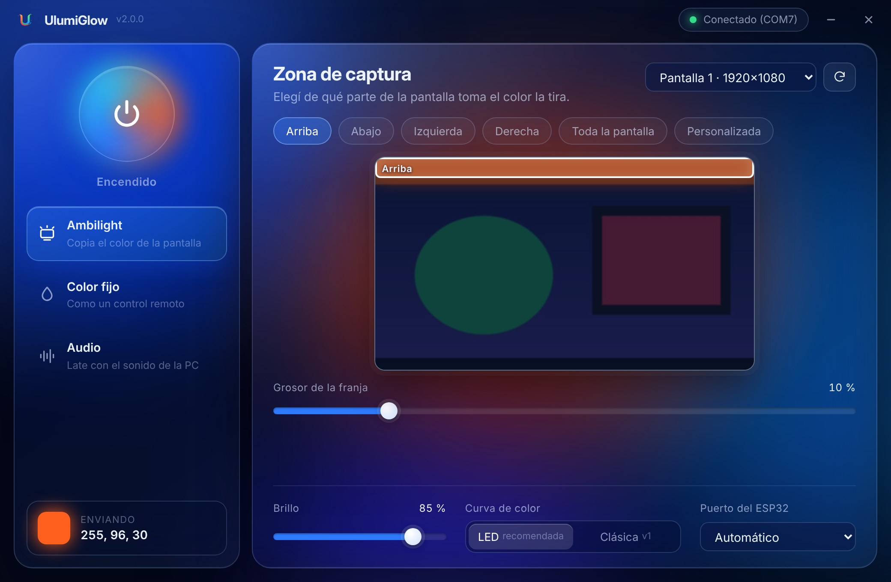
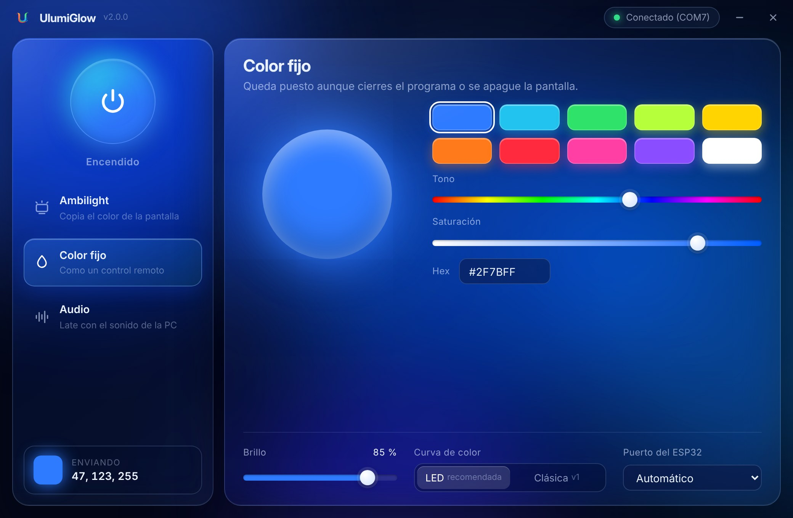
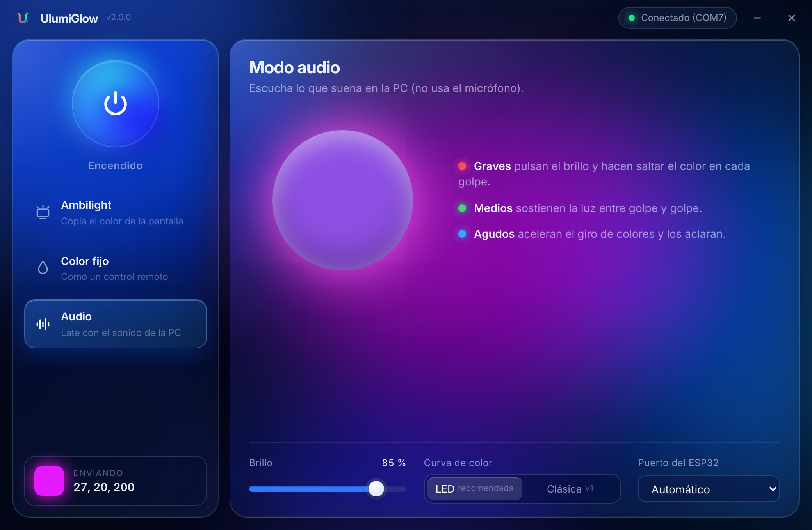
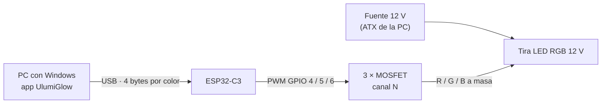
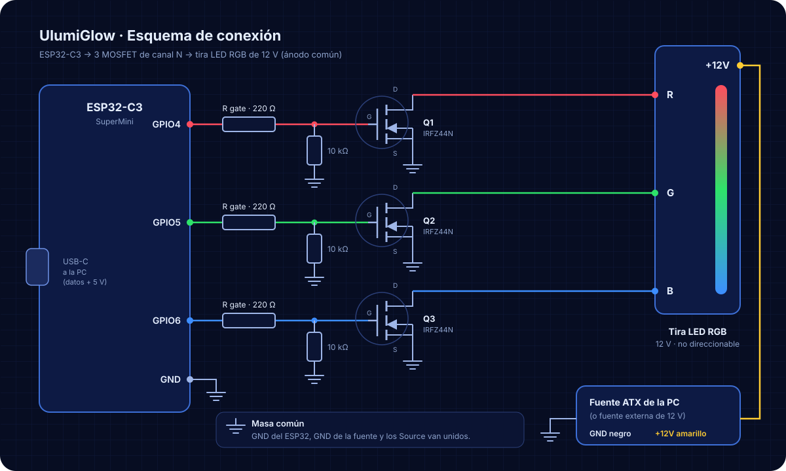

<p align="center">
  
</p>

<p align="center">
  <b>Español</b> · <a href="README.en.md">English</a>
</p>

<p align="center">
  <a href="LICENSE"></a>
  
  
  
  <a href="https://github.com/UlisesSB/UlumiGlow/releases/latest"></a>
</p>

**UlumiGlow** convierte cualquier tira LED RGB común (de las baratas, no direccionables) en una iluminación **Ambilight** para tu computadora. Un programa liviano vive en la bandeja de Windows, mira una zona de la pantalla, calcula el color promedio y se lo manda por USB a un **ESP32-C3**, que maneja la tira con PWM a través de tres MOSFETs.

La idea del proyecto es ser **simple**: pocos componentes, código corto y nada de configuración complicada.

### Apoya el proyecto

UlumiGlow es gratuito y de código abierto. Si te sirve, puedes ayudarme a seguir mejorándolo:

**Alias bancario (Argentina): `uarodriguez.wb`** &nbsp;&middot;&nbsp; Titular: Ulises Agustin Rodriguez

<sub>Cualquier aporte, grande o chico, se agradece. Una estrella en GitHub o reportar un error ayuda igual.</sub>

</div>

---

## Características

- **Ambilight**: la tira copia el color de la parte de la pantalla que elijas.
- **Mapa de zona** con presets (arriba, abajo, izquierda, derecha o toda la pantalla) o una **zona personalizada** que marcás arrastrando sobre una captura de tu monitor.
- **Color fijo**: elegís un color y queda puesto, aunque cierres el programa.
- **Modo audio**: la tira late con el sonido de la PC. Los graves marcan el pulso, los agudos hacen girar los colores.
- **Vive en la bandeja**: un clic enciende o apaga, y el clic derecho abre el menú.
- **Se reconecta solo** si desenchufás y volvés a enchufar el ESP32.
- **Apagado seguro**: en Ambilight y Audio, si la PC deja de mandar datos, la tira se apaga sola.
- **Cuida tus MOSFETs**: el firmware limita el brillo máximo para que no calienten.
- Interfaz *liquid glass* azul, brillo general y dos curvas de color para comparar.

## Capturas

<p align="center">
  
  
</p>
<p align="center">
  
  
</p>

## Cómo funciona



1. La app captura la zona elegida unas 20 veces por segundo y saca el color promedio.
2. Lo suaviza, le aplica la curva de color y el brillo, y lo manda por USB.
3. El ESP32 recibe el color y genera tres señales PWM (rojo, verde y azul).
4. Cada MOSFET conecta su canal de la tira a masa en proporción a esa señal, y así se forman los colores intermedios.

## Materiales

| Componente | Cant. | Notas |
|---|:---:|---|
| ESP32-C3 SuperMini (o cualquier ESP32-C3 con USB nativo) | 1 | Se alimenta por el mismo USB de la PC |
| MOSFET de canal N **IRFZ44N** (TO-220) | 3 | Mejor aún: IRLZ44N o IRLB8721 (nivel lógico, ver nota) |
| Resistencia de 220 Ω | 3 | Entre cada GPIO y el gate |
| Resistencia de 10 kΩ | 3 | Pull-down del gate a masa |
| Tira LED RGB 12 V **no direccionable** (4 pines: +12V, R, G, B) | 1 | Ánodo común, la más común en el mercado |
| Fuente de 12 V | 1 | Un cable de 12 V de la fuente ATX de la PC o una fuente externa |
| Protoboard o placa perforada, cables y cable USB-C de datos | – | |

> [!NOTE]
> El IRFZ44N no es de nivel lógico: con los 3,3 V del ESP32 conduce a medias y calienta. Por eso el firmware limita el brillo al 63 %. Con un IRLZ44N o un IRLB8721 podés subir `BRIGHT_LIMIT` a 255 en [`firmware/src/main.cpp`](firmware/src/main.cpp).

## Conexión

<p align="center">
  
</p>

| ESP32-C3 | Va a | Tira LED |
|---|---|---|
| GPIO 4 | Gate de Q1 (con 220 Ω) → Drain de Q1 | R |
| GPIO 5 | Gate de Q2 (con 220 Ω) → Drain de Q2 | G |
| GPIO 6 | Gate de Q3 (con 220 Ω) → Drain de Q3 | B |
| GND | Masa común (Source de los MOSFETs y GND de la fuente) | – |
| – | +12 V de la fuente | +12V |

La guía paso a paso, con consejos y solución de problemas, está en **[docs/armado.md](docs/armado.md)**.

## Instalación

1. **Armá el circuito** siguiendo el esquema de arriba.
2. **Cargá el firmware** en el ESP32-C3 con [PlatformIO](https://platformio.org/): abrí la carpeta `firmware/` en VS Code y tocá *Upload* (o ejecutá `pio run -t upload`).
3. **Instalá la app** descargando `UlumiGlow_Setup_x.y.z.exe` desde [Releases](https://github.com/UlisesSB/UlumiGlow/releases/latest).
4. Conectá el ESP32 por USB. UlumiGlow lo detecta solo y la tira se enciende.

## Uso

| Acción | Resultado |
|---|---|
| Clic en el ícono de la bandeja | Enciende o apaga la tira |
| Clic derecho → *Modo* | Cambia entre Ambilight, Color fijo y Audio |
| Clic derecho → *Configuración…* | Abre la ventana con todas las opciones |
| Cerrar la ventana | La manda a la bandeja; el programa sigue funcionando |
| Clic derecho → *Salir* | Cierra UlumiGlow (el color fijo queda puesto, los demás modos apagan la tira) |

Al abrir el programa a mano aparece una intro y después podés elegir **Configurar** o **Minimizar a la bandeja**. Cuando arranca con Windows va directo a la bandeja.

La configuración se guarda en `%APPDATA%\UlumiGlow\config.json` y el registro de errores en `ulumiglow.log`, en la misma carpeta.

## Protocolo

La app y el firmware se hablan con paquetes de 4 bytes a **115200 baudios**:

| Paquete | Uso | Si la PC deja de enviar |
|---|---|---|
| `0xAA R G B` | Color en vivo (Ambilight, Audio) | La tira se apaga a los 3 s |
| `0xAB R G B` | Color fijo (y apagado al pausar) | El color queda puesto |

## Desarrollo

```powershell
cd app
pip install -r requirements.txt
python main.py           # con intro
python main.py --tray    # directo a la bandeja
```

Cómo generar el `.exe`, el instalador y publicar una versión: **[docs/compilar.md](docs/compilar.md)**.

## Estructura del repositorio

```
UlumiGlow/
├── app/                    Programa de Windows (Python)
│   ├── main.py             Punto de entrada
│   ├── ulumiglow/          Lógica: config, ESP32, modos, motor, bandeja
│   │   └── ui/             Ventana: window.py + web/ (HTML, CSS, JS)
│   ├── assets/             Íconos de la app
│   ├── installer/          Script de Inno Setup
│   ├── build.bat           Genera el .exe con PyInstaller
│   └── requirements.txt
├── firmware/               Firmware del ESP32-C3 (PlatformIO)
├── assets/                 Logo (SVG y PNG 4096 px), ícono y banners
├── docs/                   Guías de armado y compilación, imágenes
├── CHANGELOG.md
└── LICENSE
```

## Hoja de ruta

- [ ] Varias zonas y varias tiras a la vez (más de una señal por ESP32).

## Licencia

Distribuido bajo la licencia **MIT**: podés usarlo, modificarlo y compartirlo libremente, siempre que mantengas el aviso de copyright con el crédito al autor. Ver [LICENSE](LICENSE).

La fuente [Inter](https://github.com/rsms/inter) que usa la interfaz se distribuye bajo la SIL Open Font License 1.1.

## Autor

**Ulises Agustin Rodriguez**

- Portafolio: [uarodriguez.com](https://uarodriguez.com)
- GitHub: [@UlisesSB](https://github.com/UlisesSB)
- Contacto: [uarodriguez@computer.org](mailto:uarodriguez@computer.org)

<sub>Copyright © 2025-2026 Ulises Agustin Rodriguez.</sub>
